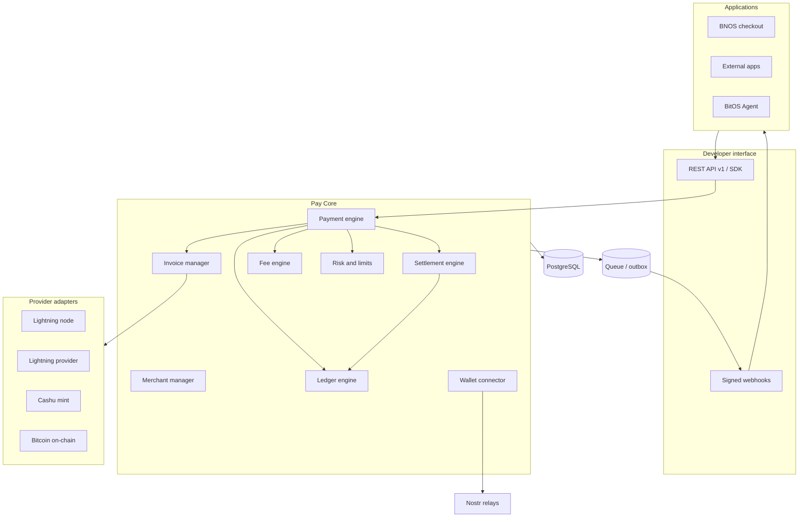

# BitOS Pay — architecture

Status: **Spec + synthetic reference core.** This describes intended components and boundaries. The `service/` reference implements a sandbox slice only; no production component runs.

## 1. Shape

Start as a modular monolith with an event-driven worker. First-market volume does
not justify microservices, and one deployment keeps ledger writes and the state
machine in one transactional boundary. The reference package layout, dependency
rules and monorepo split gates are in [STRUCTURE](STRUCTURE.md); the service
checks the domain/port/application/API/provider boundaries locally.

## 2. Modules

| Module | Owns | Must not |
| --- | --- | --- |
| Payment engine | Intent and attempt lifecycle, orchestration, idempotency | Write ledger rows directly without the ledger engine |
| Invoice manager | Invoice creation, expiry, provider reference binding | Trust a browser callback |
| Merchant manager | Organization, merchant, users, locations, verification state | Grant payment authority from a profile field |
| Ledger engine | Accounts, balanced entries, reversals, balances | Delete or update a posted entry |
| Settlement engine | Provider reconciliation, settlement records, payout state | Assume provider history is complete |
| Fee engine | Fee rule selection and fee snapshot | Recompute historical fees at read time |
| Risk and limits | Merchant status, amount and velocity limits, blocklists | Replace authorization or KYC review |
| Wallet connector | NIP-47/NWC sessions, wallet capability discovery | Store a seed or nsec |
| Plan and entitlement | Plans, subscriptions, plan invoices and versioned feature entitlements | Grant ownership, membership, roles or live merchant capability |

## 3. Main payment flow

1. BNOS calls `POST /v1/payment-intents` with merchant, external reference,
   integer amount and currency. The engine checks status, limits and idempotency,
   then creates the intent and one attempt; the invoice manager obtains and binds
   the invoice, provider reference and payment hash.
2. The API returns invoice, expiry and status. The customer pays from a
   Lightning wallet; browser polling or a read-only status stream is not evidence.
3. The provider confirms by signed callback or authenticated query. The adapter
   normalizes it; the engine verifies invoice, payee, amount and event identity.
4. In one transaction the engine records the transaction, posts balanced ledger
   entries with the fee snapshot, sets `SUCCEEDED` and writes the outbox event.
5. The worker delivers signed `payment.succeeded` and `invoice.settled` events.
   BNOS marks the order paid, issues its receipt and adjusts stock; a duplicate
   delivery must be idempotent at BNOS.

### 3.0 Provider adapters

The sandbox always uses the in-process mock provider. One live adapter is
selected with `PAY_LIGHTNING_PROVIDER=lnbits`, `blink` or `strike` plus
`PAY_LIVE_ENABLED=1` and that provider's credentials. Provisioning, intent
creation and settlement choose the adapter by `livemode`/provider-connection
mode, so a sandbox merchant cannot create a live invoice even when live is
configured. Payment creation selects the first `ACTIVE` connection for the key's
mode in creation order. The console exposes that same read-only route (provider,
mode, status and selected flag) in Settings; it never returns a credential
reference. Merchant-managed connection setup, priority, failover and credential
rotation remain planned.

Provider callbacks use provider-specific verification: LNbits uses a
constant-time token and status lookup; Blink uses Svix HMAC headers and a
five-minute timestamp window; Strike uses HMAC over the raw body and resolves the
receive-request id to a payment hash. In every case the callback is only a
trigger: the service re-reads invoice status and, where exposed, amount from the
provider before posting a transaction. Blink binds the stored invoice amount to
the payment hash instead of returning an amount with its status. Live invoices are whole-sat; sub-sat live amounts are
rejected. Blink and Strike are custodial accounts, so they do not provide
merchant-owned custody or per-merchant fund isolation.

### 3.1 Plan activation flow (planned)

1. An organization owner or billing admin selects a plan and Pay creates a
   subscription invoice through the provider adapter.
2. The subscription remains `PENDING_PAYMENT`; the browser return does not
   activate it.
3. Provider confirmation records the transaction and activates the plan for one
   organization through an explicit organization mapping.
4. Pay issues a versioned entitlement with features, limits and validity. The
   consumer checks the entitlement for feature access; roles remain local.
5. Expiry, refund or chargeback downgrades features after a bounded grace period
   without deleting records or changing ownership.

## 4. Payment state machine (`payment_intents.status`)

| From | Allowed to | Trigger |
| --- | --- | --- |
| `CREATED` | `PENDING`, `EXPIRED`, `CANCELLED` | Invoice issued, expiry, cancel before invoice |
| `PENDING` | `SUCCEEDED`, `FAILED`, `EXPIRED`, `CANCELLED` | Verified settlement, verified failure, expiry, provider-confirmed cancel |
| `EXPIRED` | `SUCCEEDED` | Provider proof shows the payment happened before expiry; recovery after a missed callback |
| `SUCCEEDED`, `FAILED`, `CANCELLED` | none | Terminal; corrections use a new record or reversal |

- A terminal intent is immutable. A retry under a non-terminal intent is a new
  attempt; retrying a terminal intent creates a new intent (`retry_of_intent_id`)
  and a new attempt, never an edit of the old record. Recovery from `EXPIRED` to
  `SUCCEEDED` is allowed only through verified settlement whose provider proof
  time is before the invoice expiry; it is not a general un-expire action.
- Within a non-terminal intent, each provider interaction is a new attempt:
  `CREATED`, `INVOICE_ISSUED`, `PENDING`, `SUCCEEDED`, `FAILED`, `EXPIRED`,
  `CANCELLED` or `QUARANTINED`.
- "Unknown" is not `FAILED`; the attempt is quarantined and never auto-retried.
  One successful attempt per intent; a second proof is a conflict, not a posting.

## 5. Consistency and delivery

- Intent, transaction, ledger entries and outbox event commit atomically;
  webhook delivery is at-least-once and consumers deduplicate by event id.
- Reconciliation compares provider history with local transactions. The ledger
  is the balance source; a provider wallet balance is a separate observation.
- Expiry is enforced by the database and a job. A settlement discovered late is
  compared with the provider payment time: before expiry it settles, at or
  after expiry it is quarantined.

## 6. Stack

| Layer | Choice | Note |
| --- | --- | --- |
| Frontend | Nuxt 4 + TypeScript + Nuxt UI | Merchant, checkout, developer console |
| Backend | Node.js + TypeScript | From the blueprint; Rust/Axum is an open alternative (PAY-D05) |
| Database | PostgreSQL | Source of truth |
| GraphQL | Hasura | Dashboard reads and projections only |
| API | REST + OpenAPI | Versioned `/v1` |
| Auth | Nostr NIP-07/NIP-46 for humans, scoped API keys for servers | Neither is payment proof |
| Payments | Lightning Network behind an adapter | Provider or node chosen later (PAY-D02) |
| Queue | Redis / BullMQ | Webhooks, expiry, reconciliation |

Hasura may not own the state machine or write payment tables. Payment Core owns
business logic and writes through controlled transactions, preserving invariants
when a dashboard mutation, worker and provider event race.

## 7. Deployment modes

| Mode | Money custody | Status |
| --- | --- | --- |
| Hosted (shared or dedicated) | None in MVP; invoices paid to merchant wallet or provider | Planned |
| Self-hosted | Merchant controls database and provider credentials | Planned |
| Merchant-controlled node | Merchant's node, Pay orchestrates only | Planned |
| Hosted custodial | BitOS holds or controls funds | Blocked (PAY-D01) |

The reference supports one live-provider slot per deployment. A **dedicated
single-tenant instance** is therefore the safe way to serve one real merchant
now. A **shared live multi-tenant deployment** requires connection-scoped
credentials and webhooks, tenant enforcement, per-merchant live activation,
reconciliation/failover and audit evidence; it is not implemented. See
[TENANCY](TENANCY.md) for the gates and [DECISIONS](DECISIONS.md) for PAY-D24.

Environment URLs are planned, not live: local, `dev-pay`, `sandbox-pay`,
`api.pay`, `pay`, `checkout.pay`, `docs.pay`; sandbox has its own keys.

See [DATA-MODEL](DATA-MODEL.md) for persistence and [OPERATIONS](OPERATIONS.md) for rollout.
