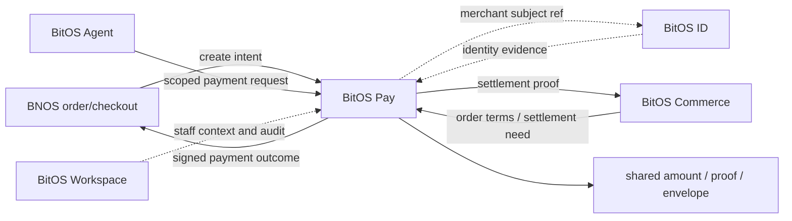

# BitOS Pay — integration

Status: **Spec**. No integration is deployed. This page defines ownership and
composition; it does not fork another product's contract.

## 1. Composition map

## 2. BNOS — first customer

| Concern | Owner |
| --- | --- |
| Order, cart, stock, receipt, fulfillment | BNOS |
| Payment intent, invoice, provider verification, transaction, ledger | BitOS Pay |
| Order-paid effect | BNOS consumes a signed Pay event |

- BNOS sends a stable order reference as `external_reference`; Pay returns an
  intent and invoice.
- Pay never writes BNOS order tables. BNOS never treats a browser redirect as
  proof of payment.
- `payment.succeeded` carries the intent id, external reference, amount,
  currency, transaction id and a settled timestamp. BNOS deduplicates by event
  id and by intent id.
- A refund or reversal is a separate Pay record that BNOS maps to its own
  receipt/adjustment flow; neither side mutates the other's history.
- The BNOS checkout contract needs sign-off before implementation (PAY-D06).

### 2.1 Workspace and console link

BNOS is local-first and already owns `/login`, `/setup`, organization and staff
records. Pay does not replace that setup. The owner explicitly connects the
active BNOS organization:

1. BNOS reads the active `organizationId` and organization name.
2. BNOS requests a Pay onboarding challenge.
3. The active NIP-07, NIP-46 or local-nsec signer signs kind `22242` with
   `relay`, `challenge` and `subject` (`bnos:<organizationId>`) tags.
4. Pay verifies the proof, maps `subject_ref` and provisions the sandbox
   organization/merchant/test key once.
5. BNOS stores the Pay connection and key per workspace and opens `/console/`
   for monitoring.
6. On later logins, BNOS refreshes an existing link without creating a new key.

Rules:

- The link proves owner-key control only. It is not a legal-business
  verification, ID membership or BNOS server attestation.
- The workspace id is the mapping key; name changes update Pay but cannot move
  the link to another owner.
- A BNOS workspace can have at most one linked Pay organization in this slice.
- Staff do not inherit the owner's Pay connection or key.
- The API key is local sandbox material and never goes to a relay or public
  event.

## 3. BitOS ID

- ID owns identity records, organization membership, key bindings, attestations
  and verification.
- The target model stores a `subject_ref` and a merchant verification state;
  the reference schema has not implemented the ID link yet. Pay does not copy
  identity claims or credential payloads.
- A verified business identity is evidence for onboarding, not payment
  authority. Merchant status, limits and keys are enforced by Pay.
- Nostr login is optional and links a pubkey to a merchant user; a pubkey alone
  never proves a legal business.
- Revocation from ID must be rechecked for privileged merchant actions; if the
  answer is unavailable, Pay fails closed for that action. See
  [BitOS ID docs](../../bitos-id-trust/docs/README.md).
- Organization mapping is only seeded in the reference: `organizations.subject_ref`
  exists but sandbox onboarding leaves it null and no ID integration populates
  it. Do not map an ID organization or private workspace to a Pay organization by
  display name. `owner_pubkey` is a local signer reference, not an ID
  `subject_ref`. A plan entitlement must reference an explicit, tenant-scoped
  mapping (PAY-D18).

## 4. BitOS Agent

- Agent Runtime owns capability grants, budgets, approvals and the tool gateway.
- Pay exposes a payment adapter; the agent sends a scoped request, never a wallet
  key, seed or nsec.
- Every agent payment is a normal payment intent with an agent subject, a
  spending-policy reference and an idempotent action id. Limits are enforced by
  Pay as well as the agent gateway.
- Unknown provider state stops the agent flow and goes to reconciliation; it is
  never retried as if it failed.
- Agent payments are P3 and out of the MVP. See
  [Agent Runtime docs](../../bitos-agent-runtime/docs/README.md).

## 5. BitOS Commerce

- Commerce owns catalog, order protocol, merchant discovery, escrow terms and
  cross-platform checkout.
- Pay owns the money movement only: intent, invoice, verification, transaction,
  ledger and settlement.
- Escrow or conditional release must not be simulated by mutating Pay intent
  states. It composes a Commerce-held condition with a Pay settlement record.
- One canonical order schema exists, owned by Commerce/BNOS. Pay references it
  and does not define a second one. See
  [Commerce docs](../../bitos-commerce/docs/README.md).

## 6. BitOS Workspace

- Workspace owns private channels, teams, documents and collaboration history.
- Pay owns payment-scoped merchant roles, API keys, webhook endpoints and the
  payment audit trail.
- A Workspace role does not grant payment permission. Pay checks its own role
  and key scope at the enforcement boundary.
- Staff context may be linked for audit display, but no document or message
  content is copied into payment records. See
  [Workspace docs](../../bitos-workspace/docs/README.md).

## 7. Shared contracts

| Contract | Use in Pay | Boundary |
| --- | --- | --- |
| [`bitos.amount/1`](../../shared/contracts/README.md) | Fiat amounts at the wire boundary | Integer minor-unit strings; BTC remains excluded, so Lightning amounts use declared sat/msat and are not silently mapped |
| [`bitos.settlement-proof/1`](../../shared/contracts/README.md) | Invoice-bound provider proof | Binds invoice ref/hash, provider, payee and amount; one payment hash settles one invoice |
| [`bitos.envelope/1`](../../shared/contracts/README.md) | Event and command composition | Idempotency, revisions, fail-closed authority |
| [`bitos.private-transport/1`](../../shared/contracts/README.md) | Private event transport | Transaction detail never appears in cleartext on a relay |

Pay adoption of these profiles is planned, not proven for its own flows. The
BTC amount exclusion and a reviewed Lightning settlement profile are open
items (PAY-D07). See also [`shared/PROTOCOL.md`](../../shared/PROTOCOL.md).

## 8. Nostr and wallet standards

| Standard | Use | Not used for |
| --- | --- | --- |
| NIP-01 | Signed event and relay transport foundation | Payment proof |
| NIP-05 | Identity verification reference | Authority |
| NIP-17 | Private messages for receipts or support | Public receipts |
| NIP-47 | Nostr Wallet Connect to a merchant wallet | General checkout verification |
| NIP-57 | Zaps | Merchant checkout |
| LNURL | Payment request and Lightning address | Settlement proof |

No event kind is invented or reserved. Kind allocation belongs to the BNOS
registry owner (ADR-025). Pay publishes no transaction to a public relay by
default; any public receipt projection is explicit, allowlisted, opt-in and
rebuildable.

## 9. Anti-patterns

1. Trusting a browser `success` callback as payment proof.
2. Letting BNOS and Pay both own the order state.
3. Copying identity claims into payment tables.
4. Treating a Workspace or ID role as payment permission.
5. Retrying an unknown provider state as a failure.
6. Publishing invoice or customer detail to a relay.
7. Choosing a Nostr kind locally to "finish" an integration.
8. Reinterpreting an existing third-party event kind as a payment event.
